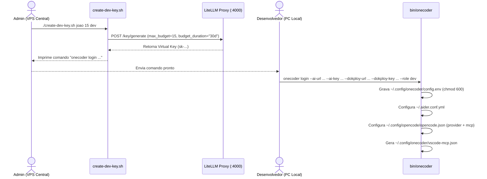
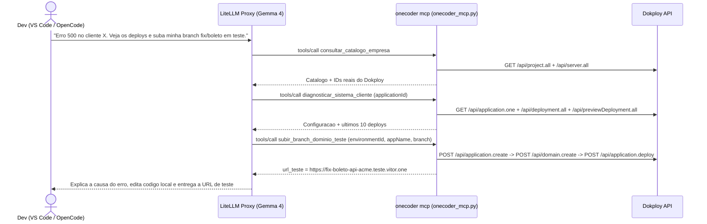

# Spec 01 — Arquitetura e Fluxos do Sistema

## 1. Mapa de Módulos

| Módulo | Caminho | Responsabilidade |
| :--- | :--- | :--- |
| **Control Plane (IA + Deploy)** | [central-server/](../../central-server/) | Provisiona Dokploy + Tailscale + LiteLLM Proxy + Postgres e armazena o `company-catalog.json`. |
| **Provisionamento de Clientes** | [scripts/bootstrap-client-vps.sh](../../scripts/bootstrap-client-vps.sh) | Prepara VPS limpa de cliente (Docker, Tailscale, chave SSH do Dokploy, UFW). |
| **Agente Operacional (MCP)** | [mcp-server/onecoder_mcp.py](../../mcp-server/onecoder_mcp.py) | Servidor MCP JSON-RPC 2.0 via `stdio` que conecta VS Code e OpenCode ao catálogo e ao Dokploy. |
| **CLI do Desenvolvedor** | [bin/onecoder](../../bin/onecoder) | Gerencia login local, configuração de OpenCode/Aider/VS Code, servidor MCP e deploys. |

---

## 2. Fluxo 1 — Onboarding de Desenvolvedor



---

## 3. Fluxo 2 — Onboarding de VPS de Cliente (Zero-SSH para Devs)

```mermaid
sequenceDiagram
    actor Admin as Admin
    participant VPS as VPS do Cliente (Ubuntu/Debian)
    participant TS as Rede Tailscale
    participant Dokploy as Dokploy Central

    Admin->>VPS: bootstrap-client-vps.sh --tailscale-key ... --hostname cliente-acme-prod --dokploy-pubkey ... --lock-ssh
    VPS->>VPS: Instala Docker Engine + Compose
    VPS->>TS: tailscale up --authkey ... --hostname ... --ssh
    VPS->>VPS: Adiciona dokploy-pubkey em /root/.ssh/authorized_keys
    VPS->>VPS: Configura UFW (libera 80/443 e tailscale0; fecha porta 22 publica)
    VPS-->>Admin: Exibe IP privado Tailscale (100.x.x.x)
    Admin->>Dokploy: Cadastra Remote Server com o IP Tailscale
```

---

## 4. Fluxo 3 — Diagnóstico e Ambiente de Teste por Branch (VS Code / OpenCode)



---

## 5. Arquivos de Configuração e Variáveis

### 5.1 `~/.config/onecoder/config.env` (PC do Dev, `chmod 600`)

| Variável | Descrição | Exemplo |
| :--- | :--- | :--- |
| `ONECODER_AI_URL` | URL base do LiteLLM Proxy (sem `/v1`) | `https://ia.vitor.one` |
| `ONECODER_AI_KEY` | Virtual Key individual do dev | `sk-...` |
| `ONECODER_DOKPLOY_URL` | URL base do painel Dokploy | `https://deploy.vitor.one` |
| `ONECODER_DOKPLOY_KEY` | API Key usada no header `x-api-key` | `...` |
| `ONECODER_DEFAULT_MODEL` | Modelo padrão no `onecoder code` | `gemma-4-31b` |
| `ONECODER_ROLE` | Perfil de permissão (`dev` ou `admin`) | `dev` |
| `ONECODER_PREVIEW_DOMAIN` | Domínio coringa para ambientes de teste | `teste.vitor.one` |

### 5.2 `.onecoder.json` (Raiz do repositório do projeto)

Template em [templates/.onecoder.example.json](../../templates/.onecoder.example.json):
```json
{
  "client": "nome-do-cliente",
  "type": "application",
  "id": "applicationId-ou-composeId-no-dokploy"
}
```

### 5.3 `central-server/company-catalog.json`

Armazena `company`, `engineering_rules`, `stack_standards` e `clients` (cada cliente com `name`, `vps_hostname`, `tailscale_ip` e lista `systems`). Pode ser sobrescrito via variável `ONECODER_CATALOG_PATH`.
